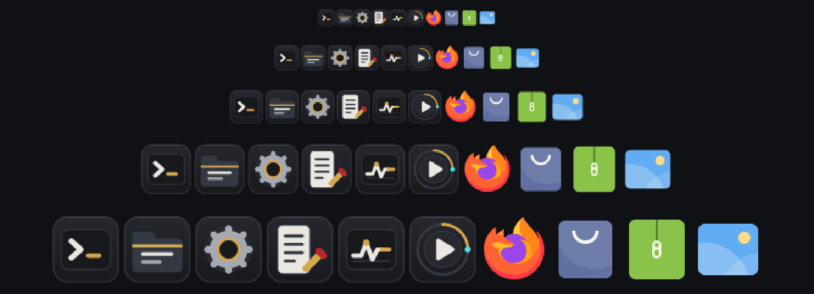
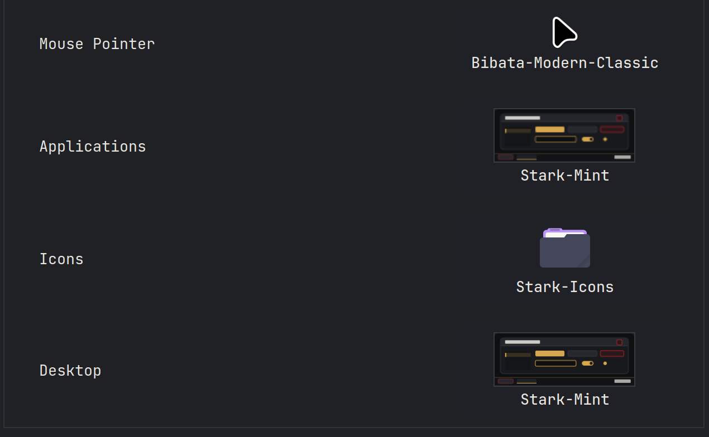
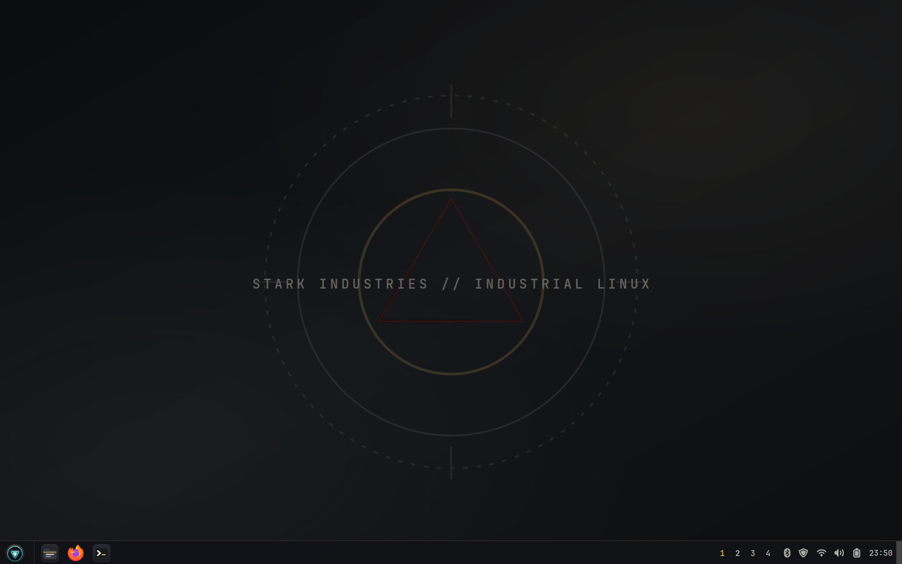
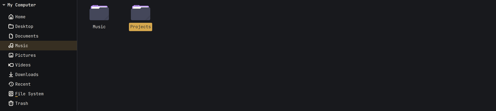
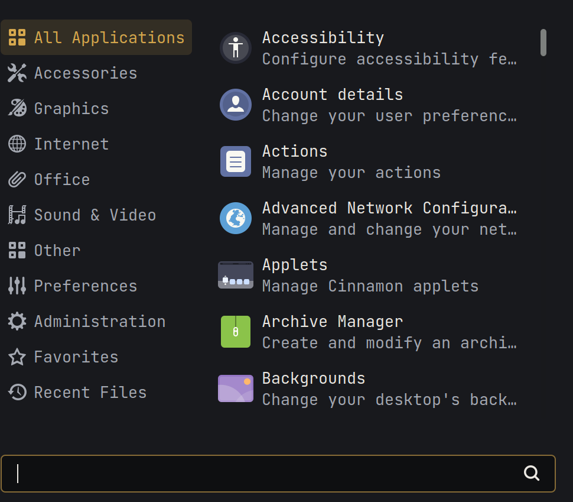

# Stark Icons

**An industrial icon theme for Linux desktops. Graphite surfaces, gold accents,
built to sit beside [Stark Mint](https://github.com/karthikeyamadhavan123/stark-mint-theme).**

This repository also ships **Stark Cursors**, a matching pointer theme — see
[Cursor theme](#cursor-theme).

Stark Icons is an adaptation of
[Dracula Icons](https://github.com/m4thewz/dracula-icons) by Matheus Vitor. It
keeps that theme's full coverage — around 25,000 files across apps, mimetypes,
places, devices, actions and symbolic icons — and replaces a small set of
signature desktop icons with original artwork in the Stark palette.

Most of what you see is still upstream work. See [Credits](#credits).

**GPL-3.0**

---

## Preview

### The Stark icons



The six redesigned icons at every size they need to work at, with four
untouched Dracula icons on the right for comparison.

### Paired with Stark Mint



Applications and Desktop set to Stark Mint, Icons set to Stark Icons. The two
are built to be used together.

### On the desktop



### Files



### Application menu



> `Preview.png` in the repository root is Dracula's original preview and shows
> the old purple and green icons. It is kept for attribution, not as a preview
> of this theme.

---

## Install

```bash
git clone https://github.com/karthikeyamadhavan123/Stark-Icons ~/.icons/Stark-Icons
```

Or download the repository and move it to `~/.icons` (create the folder if it
does not exist), or to `/usr/share/icons` for all users.

Then: **Themes → Icons → Stark Icons**.

If it does not appear:

```bash
gtk-update-icon-cache -f ~/.icons/Stark-Icons
```

then `Ctrl+Alt+Esc` to restart Cinnamon. Cinnamon caches icon themes, so this
is usually the step that makes a new or edited theme show up.

### Pairs with Stark Mint

[Stark Mint](https://github.com/karthikeyamadhavan123/stark-mint-theme) is the matching desktop theme — same palette, same
graphite-and-gold direction. The two are designed to be used together, but
either works on its own.

### Do not copy this with `cp -r`

This theme is about 8,700 symlinks. One icon file often serves dozens of
application names, and the five `@2x` entries are links, not copies.

`cp -r` follows every link and writes a separate copy. The result still works,
but it grows from 69 MB to over 200 MB, and editing one icon no longer updates
the other names that shared it.

Use `git clone`, `cp -a`, or `rsync -a`. After any copy or archive round trip:

```bash
find . -type l | wc -l                         # expect 8763
find . -type l ! -exec test -e {} \; -print    # must print nothing
du -sh --exclude=.git .                        # expect ~69M
```

Zip flattens symlinks, and some graphical archivers silently skip the five
`@2x` directory links to avoid recursion. `git clone` avoids all of it.

---

## Cursor theme

`Stark-Cursors/` is a separate pointer theme that lives in this repository but
installs to its own directory.

> **It must be copied out of the icon theme folder.** Cursor themes are only
> found at `~/.icons/<name>/index.theme`. Left inside `Stark-Icons/`, it sits
> one level too deep and will not appear in your settings.

```bash
cp -r ~/.icons/Stark-Icons/Stark-Cursors ~/.icons/
```

Then **Themes → Mouse Pointer → Stark Cursors**. Log out and back in — cursor
themes are read once at session start.

### What is in it

| Path               | Contents                                                                    |
| ------------------ | --------------------------------------------------------------------------- |
| `cursors/left_ptr` | The default pointer, built at 24, 32, 48, 64 and 96px                       |
| `cursors/*`        | Alias symlinks, including the two hash-named ones some applications request |
| `left_ptr.svg`     | Editable source                                                             |
| `build_cursor.py`  | Builds the XCursor binary from the SVG                                      |
| `index.theme`      | Inherits Adwaita for every shape not yet drawn                              |

The pointer is graphite with a bone outline, so it stays visible on dark,
light and mid-grey backgrounds, with a gold leading edge. Hotspot is at the
tip and scales with size.

### Rebuilding after editing the SVG

```bash
cd Stark-Cursors
python3 build_cursor.py left_ptr.svg cursors/left_ptr 2 2 32 24 32 48 64 96
```

Arguments are: source SVG, output path, hotspot x, hotspot y, the SVG's canvas
size, then the pixel sizes to render. The hotspot is scaled for each size
automatically. Requires `cairosvg` and `pillow`.

A deprecation warning from Pillow about `getdata` is expected and harmless.

### Status

One pointer so far, out of roughly forty shapes a complete theme uses.
`Inherits=Adwaita` means everything not yet drawn falls back to Adwaita, so
nothing breaks — but you will see Adwaita's I-beam over text fields and its
resize arrows at window edges.

Next in order of how often they appear: `xterm` (text), `hand2` (links),
`watch` (busy), then the eight resize arrows.

---

## What is different

Eight files carry original Stark artwork. Everything else is upstream.

| Icon           | Resolves for                                              |
| -------------- | --------------------------------------------------------- |
| Terminal       | `gnome-terminal`, `org.gnome.Terminal` and 43 other names |
| File manager   | `nemo`, `system-file-manager` and 20 others               |
| Settings       | `preferences-system` and 26 others, at scalable and 16px  |
| Text editor    | `xed`, `accessories-text-editor` and 29 others            |
| System monitor | `gnome-system-monitor` and 15 others                      |
| Media player   | `xplayer`, `totem` and 8 others                           |

Brand icons such as Firefox are left alone deliberately. Changing them costs
recognition without making the desktop more coherent.

### Palette

| Name         | Hex       |
| ------------ | --------- |
| Graphite     | `#18191D` |
| Charcoal     | `#26282E` |
| Steel        | `#343842` |
| Bone         | `#EBE8E2` |
| Silver       | `#A5A9B2` |
| Stark Gold   | `#D6A84E` |
| Stark Red    | `#B3272D` |
| Reactor Cyan | `#55DEE0` |

---

## Documentation

| File                                   | What it covers                                                                         |
| -------------------------------------- | -------------------------------------------------------------------------------------- |
| [DESIGN.md](./DESIGN.md)               | Design philosophy, palette rules, construction, when to redraw an icon and when not to |
| [STARK-CHANGES.md](./STARK-CHANGES.md) | Every modified file, why it changed, what was left untouched                           |
| [CONTRIBUTING.md](./CONTRIBUTING.md)   | How to contribute, and the symlink rules                                               |
| `Stark-Cursors/`                       | The matching pointer theme — see [Cursor theme](#cursor-theme)                         |

Read `DESIGN.md` before drawing anything.

---

## Credits

Stark Icons is not original work from scratch. The great majority of the
artwork comes from three upstream projects, all GPL-3.0:

| Project                                                                 | Author                   | Contribution                                                     |
| ----------------------------------------------------------------------- | ------------------------ | ---------------------------------------------------------------- |
| [Dracula Icons](https://github.com/m4thewz/dracula-icons)               | Matheus Vitor            | The theme this is adapted from: structure, coverage, recolouring |
| [Tela Circle](https://github.com/vinceliuice/Tela-circle-icon-theme)    | vinceliuice              | Apps, mimetypes, scalable devices — via Dracula                  |
| [Papirus](https://github.com/PapirusDevelopmentTeam/papirus-icon-theme) | Papirus Development Team | Places, actions, 16/22/24 devices — via Dracula                  |

Please keep these credits. They are required by the licence, and they are
accurate: this project is a small set of changes on top of a great deal of
other people's work.

## Licence

GNU General Public License v3.0. See [LICENSE](./LICENSE).

The original Stark artwork is released under the same licence, so the theme can
be redistributed as one piece.

## Trademarks

Stark Icons is an independent community project, not affiliated with or
endorsed by Marvel, Disney, Linux Mint, or the authors of Dracula Icons, Tela
or Papirus. Application icons are named for the programs they theme; those
trademarks belong to their owners.
